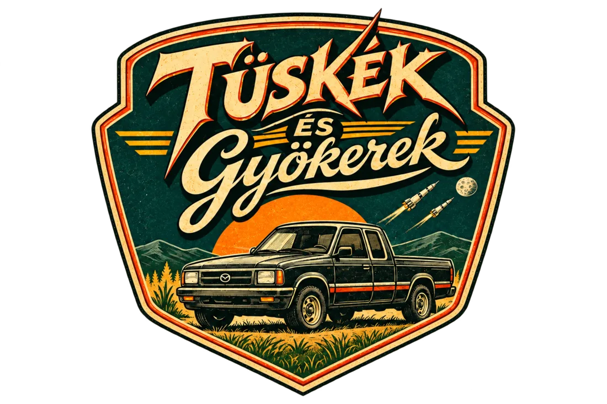

<p align="center">
  <a href="https://tuskek-gyokerek.petervivo.chatgpt.site/">
    
  </a>
</p>

# spi3derr

**spi3der in Rust**: one program for the terminal, the browser and the desktop. A 3D workshop for
[3Draft](https://github.com/Pengeszikra/3Draft) scenes, from the family of
[Spider Paint](https://github.com/Pengeszikra/spider-paint) and [spi3der](https://github.com/Pengeszikra/spi3der).

> **This release only reserves the name.** The first real iteration will be **the winner of the spid3err contest**:
> two dependency-free Rust ports of spider-paint's terminal version (v26.11.26003), written by Claude Opus 5.5. The
> winning entry becomes the first version published here.

```sh
cargo install spi3derr
spi3derr
```

## Contest entries

- [spid3err--opus](https://github.com/Pengeszikra/spid3err--opus)

## Tüskék és Gyökerek

spi3derr is made in [Tüskék és Gyökerek](https://tuskek-gyokerek.petervivo.chatgpt.site/), an independent software
workshop: 3Draft, HEXAW, Spider Paint, Five Percent and spi3der. Fewer dependencies, more room to create.

## License

[MIT](LICENSE) © 2026 Vívó Péter
